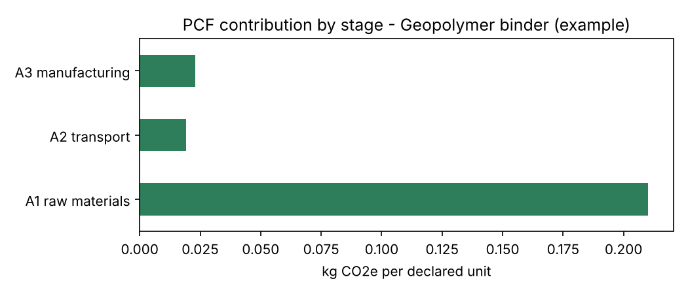

# PCF Calculator – cradle-to-gate Product Carbon Footprint from a bill of materials

A small Python tool that calculates the **Product Carbon Footprint (PCF)** of a product from its bill of materials (BOM), following the logic of **ISO 14067**, the **GHG Protocol Product Standard** and the **TfS PCF Guideline** (simplified).

The example product is **1 kg of geopolymer binder** (fly ash, GGBS, sodium silicate, sodium hydroxide, water).



## What it does

1. **Reads the input data** from CSV files: the BOM, the emission factors and the process data (energy use, losses).
2. **Checks the mass balance.** Raw-material inputs must equal product output plus expected process losses, within a tolerance. This catches data-entry errors before any calculation.
3. **Calculates the PCF per declared unit**, split into life-cycle stages:
   - **A1 – raw materials:** uses the **supplier-specific PCF (primary data)** where the supplier provided one, and a generic emission factor (secondary data) otherwise. This is the hierarchy recommended by TfS and PACT.
   - **A2 – transport:** tonne-kilometres × emission factor per transport mode.
   - **A3 – manufacturing:** electricity and natural gas use on site.
4. **Reports the Primary Data Share**: the share of the PCF based on primary data, as used in PACT and TfS.
5. **Runs a scenario** with renewable electricity. The model is parameterised, so a scenario is one function argument.
6. **Saves the outputs:**
   - a results table (`pcf_results.csv`)
   - a chart (`pcf_by_stage.png`)
   - a structured **JSON record** (`pcf_record.json`), inspired by the PACT data model and the kind of data a **Digital Product Passport** needs

## Run it

```bash
pip install -r requirements.txt
python pcf.py     # calculate and save the results
pytest            # run the checks
```

Example output:

```
Mass balance: OK
PCF of Geopolymer binder (example): 0.252 kg CO2e per kg (cradle-to-gate)
A1 raw materials    0.2100
A2 transport        0.0192
A3 manufacturing    0.0230
Primary data share: 72%
Scenario with renewable electricity: 0.235 kg CO2e per kg (-6.9%)
```

## Use your own product

Edit the three CSV files. No code changes are needed:

| File | What goes in it |
|---|---|
| `bom_geopolymer_binder.csv` | Components, mass per declared unit, supplier PCF (if available), transport mode and distance |
| `emission_factors.csv` | Generic factors for materials, transport and energy |
| `process.csv` | Declared unit, expected losses, energy use |

If a material has no emission factor, the script stops and names the missing material, so a gap is never silently counted as zero.

## Important limitations

- **All emission factors are illustrative placeholders, not real data.** A real study would use licensed databases (such as ecoinvent) and verified supplier PCFs.
- The scope is cradle-to-gate (A1–A3) and covers fossil GHG emissions only. Biogenic carbon, allocation and end-of-life are not modelled.
- This is a learning and demonstration project, not a verified LCA tool.

## Possible next steps

- Read BOM data directly from an ERP export (e.g. SAP) instead of a hand-made CSV
- Exchange supplier PCFs in the PACT data format via API
- Add uncertainty and data-quality ratings per input
- Connect to openLCA through its Python interface (olca-ipc) for full LCA calculations
